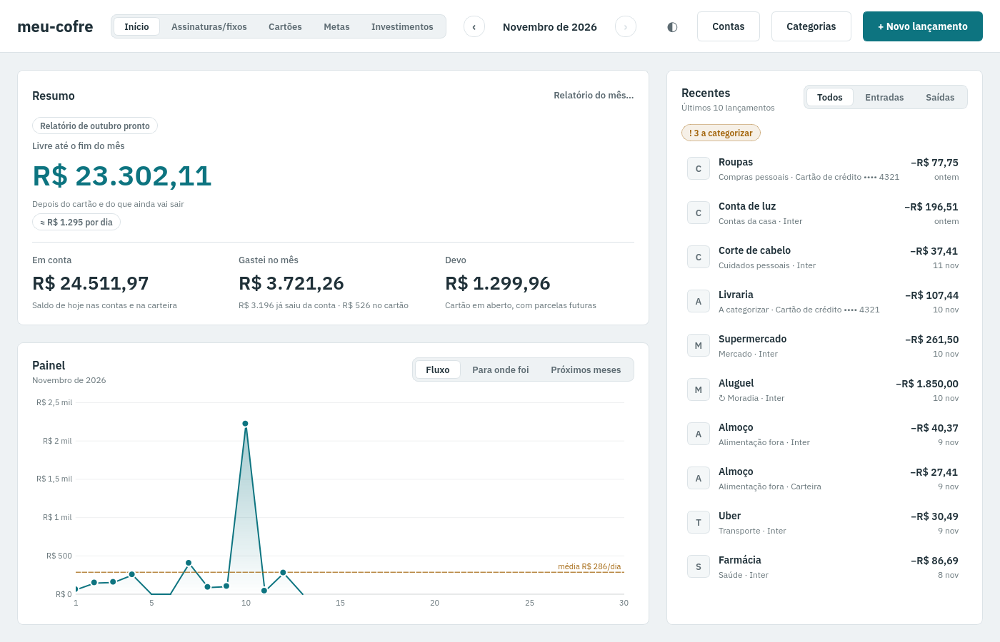
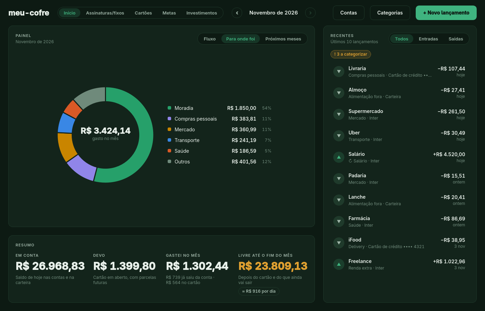
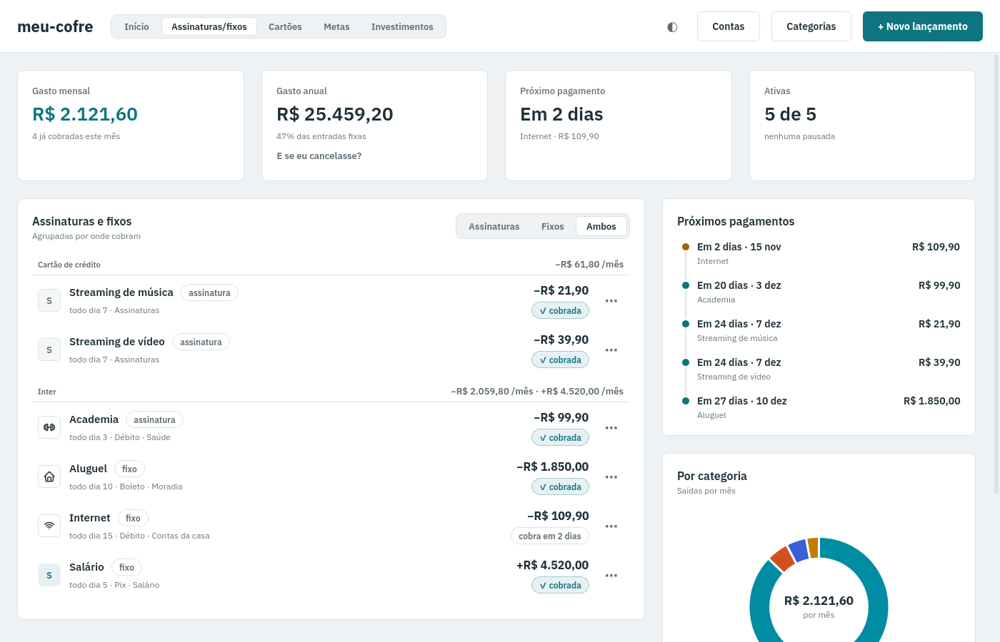
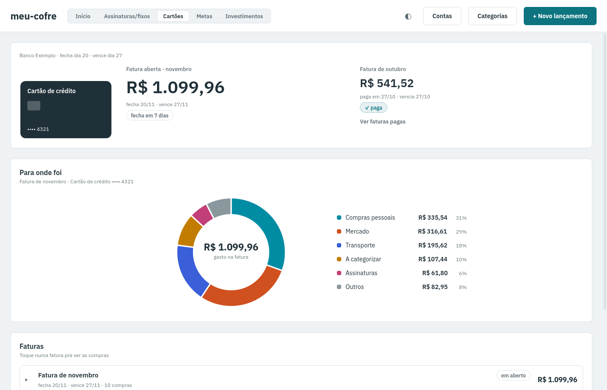
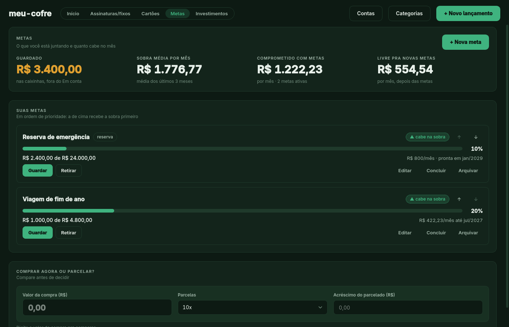
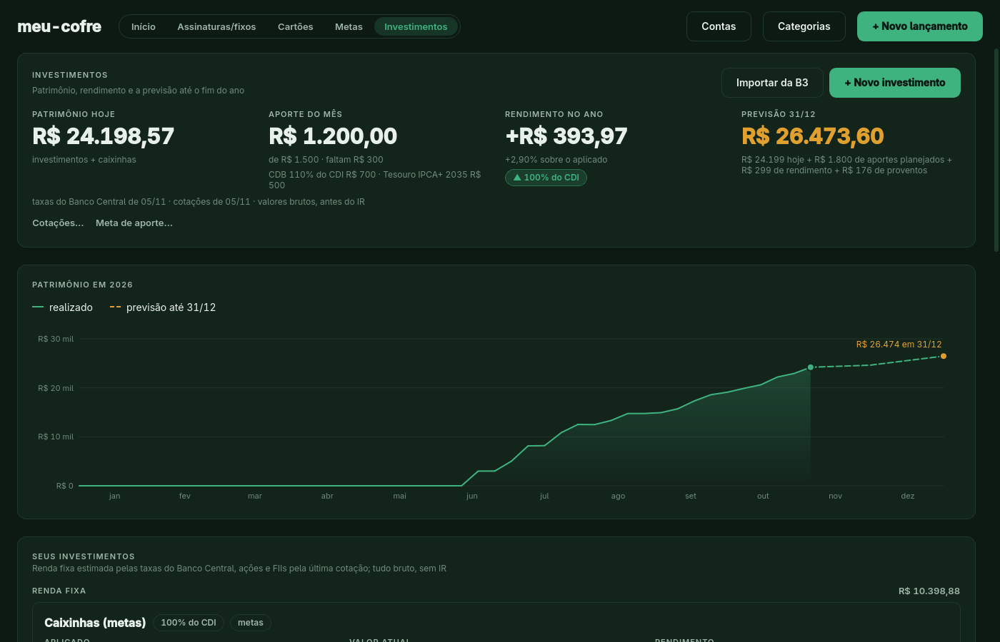
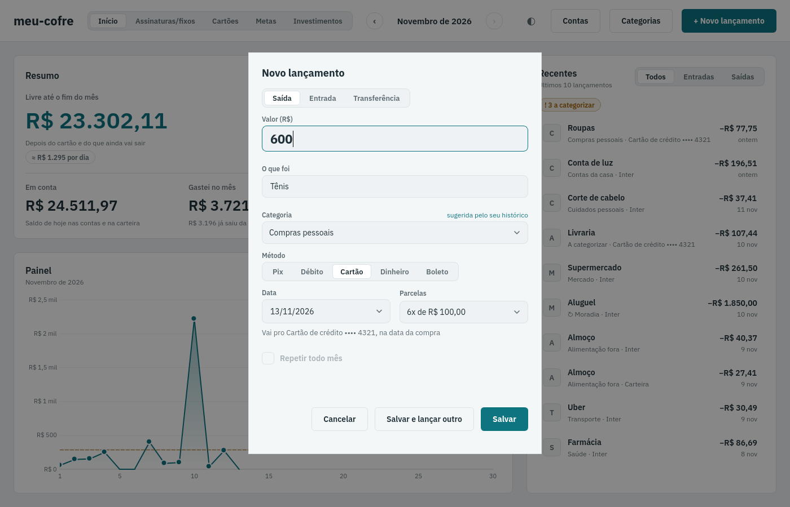

# meu-cofre

Aplicativo desktop de finanças pessoais que roda só no seu computador. Você lança gastos em poucos segundos e vê pra onde o dinheiro foi, o que já está comprometido nos próximos meses, as faturas do cartão, as metas e os investimentos. Feito com Python, SQLite, pandas e PySide6 (Qt).

**Os seus dados nunca saem do PC.** Tudo fica num arquivo SQLite local. A única coisa que usa a internet são consultas públicas: as taxas do Banco Central (CDI, Selic, IPCA) e as cotações de ações e FIIs. Nessas consultas só vai o número da série ou o ticker, nunca valores, quantidades ou lançamentos. Sem internet o app funciona normalmente, com a última taxa e cotação guardadas.

Os prints abaixo usam dados de demonstração gerados por `scripts/dados_demo.py`.

*Início: fluxo do mês, resumo (em conta, devo, gastei, livre até o fim do mês) e lançamentos recentes.*

*O mesmo painel trocado para "Para onde foi" (gasto por categoria).*

*Assinaturas e fixos: o que se repete todo mês, agrupado por onde cobra.*

*Cartões: fatura aberta, faturas pagas e gasto por categoria da fatura.*

*Metas: progresso, valor por mês necessário e simulador de compra à vista ou parcelada.*

*Investimentos: patrimônio, aporte do mês contra a meta, rendimento no ano e previsão até 31/12.*

*Novo lançamento: categoria sugerida pelo histórico e parcelamento no cartão.*

## Funcionalidades

**Início.** Painel com três visões (fluxo de gasto por dia, gasto por categoria e próximos meses, com o que já está comprometido), resumo do mês e lista de recentes (todos, entradas, saídas). Navega entre os meses. A fila "A categorizar" reúne lançamentos sem categoria.

**Assinaturas/fixos.** Molde mensal (descrição, valor, conta, dia do mês) que gera os lançamentos de cada mês: previstos até a data chegar, realizados depois. Dá pra pausar, editar e encerrar. Mostra o custo mensal, o total por ano e o que já foi cobrado no mês.

**Cartões.** Cada cartão tem dia de fechamento e de vencimento. Mostra a fatura aberta, as próximas e as pagas, com as compras (inclusive parcelas futuras) e o gasto por categoria. Pagar a fatura aceita valor parcial ou a mais.

**Metas.** Metas com prazo ou com valor mensal, em ordem de prioridade, com a reserva de emergência no topo. Guardar e retirar movem dinheiro entre a conta e a conta "Caixinhas". Diz se a meta cabe na sobra média dos últimos meses e tem o simulador "comprar agora ou parcelar?".

**Investimentos.** Renda fixa (CDB, em % do CDI, Selic, IPCA+ ou prefixado), Tesouro, caixinhas das metas, ações e FIIs. Patrimônio, rendimento no ano comparado ao CDI, meta de aporte mensal e previsão para 31/12. Renda fixa é estimada pelas taxas do Banco Central (valores brutos, sem IR). Ações e FIIs têm preço médio, resultado, proventos recebidos e estimativa dos próximos 12 meses.

**Contas e Categorias.** Contas correntes, carteira e cartões, com saldo inicial; categorias com natureza (essencial, flexível, supérfluo) e regras de categorização (descrição que contém um texto ou casa com uma regex vira uma categoria, menor prioridade vence).

**Importação.**
- Extrato OFX (Contas > Importar extrato), testado com os formatos do Inter e da Caixa. Mostra uma prévia antes de gravar.
- Planilha de movimentações da Área do Investidor da B3 (Investimentos > Importar da B3), também com prévia.

**Atalhos.** `Ctrl+N` novo lançamento, `Ctrl+1` a `Ctrl+5` trocam de aba, `Enter` salva e `Esc` cancela no diálogo, `Ctrl+Enter` salva e lança outro.

## Arquitetura

A lógica fica em módulos Python sem Qt, que recebem uma conexão SQLite e devolvem números, dataclasses ou DataFrames. A interface só chama esses módulos. Por isso quase tudo é testado sem abrir janela.

    app/meu_cofre/
      config.py         caminho do banco (MEU_COFRE_DB ou data/)
      db.py             conexão, criação do schema, preferências
      migracoes.py      migrações versionadas e backup
      schema.sql        tabelas (esquema mais recente)
      seed.py           contas e categorias iniciais
      lancamentos.py    registrar, listar, editar, sugerir categoria, transferências
      cadastros.py      contas, cartões, categorias e regras
      relatorios.py     números da tela inicial
      recorrentes.py    assinaturas e fixos
      faturas.py        fatura de cartão: qual compra cai onde, total, pagamento
      metas.py          metas, viabilidade e simulador
      investimentos.py  renda fixa e Tesouro, patrimônio, previsão
      renda_variavel.py ações e FIIs: operações, preço médio, proventos
      indicadores.py    CDI, Selic e IPCA do Banco Central (cache em SQLite)
      cotacoes.py       cotações e proventos por cota (cache em SQLite)
      importar_ofx.py   extrato OFX
      importar_b3.py    planilha da B3
      ui/               interface PySide6 (só chama o pacote)
        app.py          comando `meu-cofre` e modo de screenshot
        janela.py       janela principal e tela inicial
        aba_*.py        abas Assinaturas/fixos, Cartões, Metas, Investimentos
        dialogo_*.py    diálogos (lançamento, contas, categorias, importações...)
        atualizador.py  busca de taxas e cotações em segundo plano
        graficos.py, componentes.py, tema.py
    scripts/            dados de demonstração, prints do README, atalho Linux
    tests/              pytest

## Decisões de dados

- **Centavos, sempre inteiros.** Nenhum `float` guarda dinheiro. O sinal é a direção: saída negativa, entrada positiva. Só se formata em reais na tela.
- **Transferência tem dois lados.** Mover dinheiro entre contas, guardar em meta, aportar em investimento ou pagar fatura cria uma saída e uma entrada ligadas pelo mesmo `transferencia_id`. Não contam como gasto nem como renda.
- **Fatura de cartão.** A compra cai na fatura pelo dia de fechamento, e a fatura é identificada pelo mês do vencimento. Comprar no cartão não tira dinheiro da conta: isso só acontece ao pagar a fatura, que é uma transferência conta para cartão, então o gasto não conta duas vezes. Compra parcelada gera uma parcela por fatura.
- **Migrações versionadas.** O esquema tem versão em `PRAGMA user_version`. Ao abrir um banco antigo, o app copia o arquivo para uma pasta `backups/` ao lado dele e aplica as migrações pendentes, cada uma numa transação (se falhar, volta tudo e a versão não muda).
- **Conciliação de extratos.** A deduplicação usa o `FITID` quando o banco o gera de verdade; em OFX convertido de PDF, onde o `FITID` é inventado, usa um hash de conta, data, valor, descrição e ordem entre transações idênticas do mesmo dia. Uma transação do extrato casa com um lançamento manual da mesma conta e valor numa janela de até 3 dias, e se houver mais de um candidato você escolhe. O saldo inicial da conta pode ser ajustado para fechar com o `LEDGERBAL` (saldo final) do extrato. Importar o mesmo arquivo duas vezes não duplica nada.
- **Importação em duas etapas.** Primeiro uma prévia que não grava nada (novas, duplicadas, ignoradas com o motivo), depois a confirmação, tudo numa transação.
- **Taxas e cotações em segundo plano.** A rede roda numa thread e só a gravação acontece na thread principal, então a janela nunca espera. Há um intervalo mínimo entre tentativas, a busca de taxas é incremental (só o que falta) e qualquer falha de rede vira um aviso, não um erro.
- **Estimativa, não extrato.** Renda fixa e Tesouro são calculados pelas taxas públicas (dias úteis, feriados nacionais), e a tela marca o que é estimado. Você pode registrar o saldo real quando quiser acertar.

## Baixar pronto (executáveis)

Na página de [Releases](https://github.com/Gabiue/Meu-Cofre/releases) há um arquivo por sistema, sem precisar instalar Python nem uv:

- **Linux:** `meu-cofre-x86_64.AppImage`. Dê permissão (`chmod +x meu-cofre-x86_64.AppImage`) e execute. Pra aparecer no menu, use o [AppImageLauncher](https://github.com/TheAssassin/AppImageLauncher), se quiser.
- **Windows:** `meu-cofre.exe`. Como o arquivo não é assinado, o SmartScreen avisa: clique em "Mais informações" e depois em "Executar assim mesmo".

Os dados ficam no mesmo lugar da instalação normal (`~/.local/share/meu-cofre/` no Linux, `%APPDATA%\meu-cofre\` no Windows); o executável nunca grava ao lado de si. O subcomando `relatorio` funciona no AppImage; o `.exe` não tem console, então a saída dele não aparece no Windows.

Pra gerar localmente: `uv run --group build python scripts/build.py` (`--fumaca` abre o resultado offscreen e confere). No Linux ele monta `build/AppDir`; passe `--appimagetool CAMINHO` pra gerar o `.AppImage`.

## Como rodar

### Instalação (Linux)

Requer [uv](https://docs.astral.sh/uv/) (o instalador avisa como obter, mas não instala nada sozinho). Clone e instale, ou baixe o ZIP, extraia e rode o mesmo comando:

    git clone https://github.com/Gabiue/Meu-Cofre.git && cd Meu-Cofre
    sh scripts/instalar.sh

Cria o atalho no menu e o ícone, no padrão freedesktop (KDE, GNOME, XFCE, rofi). Num clone git, o atalho roda uma cópia estável da `main` em `~/.local/share/meu-cofre/estavel`, então trocar de branch na pasta do projeto não muda o app aberto; sem git (ZIP), roda a própria pasta.

- **Banco:** `MEU_COFRE_DB` se definida; senão `data/meu-cofre.db` do projeto, se já existir (instalação antiga); senão `~/.local/share/meu-cofre/meu-cofre.db`. Nada é movido nem copiado.
- **Atualizar:** `git pull` e `sh scripts/instalar.sh` de novo (num ZIP, extraia a versão nova e rode o instalador).
- **Remover:** `sh scripts/instalar.sh --remover` apaga só o atalho e o ícone; banco e cópia estável ficam.

### Instalação (Windows)

Suporte novo: os testes rodam na CI em `windows-latest`, mas ainda não foi usado num Windows de verdade. Se algo falhar, abra uma issue.

Requer o [uv](https://docs.astral.sh/uv/) (`winget install astral-sh.uv`; o instalador avisa se faltar, mas não instala nada sozinho). Clone ou baixe o ZIP e extraia; no PowerShell, dentro da pasta:

    powershell -ExecutionPolicy Bypass -File scripts\instalar.ps1

Cria o atalho `meu-cofre` no Menu Iniciar (sem janela de console) e o ícone. O atalho roda a própria pasta do projeto, sem a cópia estável do Linux.

- **Banco:** `MEU_COFRE_DB` se definida; senão `data\meu-cofre.db` do projeto, se já existir; senão `%APPDATA%\meu-cofre\meu-cofre.db`. Os relatórios ficam em `relatorios\` ao lado dele.
- **Atualizar:** `git pull` e o instalador de novo.
- **Relatório automático:** `powershell -ExecutionPolicy Bypass -File scripts\instalar-relatorio-automatico.ps1` cria uma tarefa agendada (dia 1, 8h; roda depois se o PC estava desligado). Se existir `%APPDATA%\meu-cofre\depois-do-relatorio.ps1`, ele é chamado com o caminho do arquivo.
- **Remover:** `-Remover` em cada um dos dois scripts; banco e relatórios ficam.

### Direto da pasta

Requer Python 3.12 ou mais novo.

    uv sync
    uv run meu-cofre

O banco segue a regra acima (criado na primeira execução).

Para conhecer o app sem dados reais, gere um banco de demonstração (dados falsos, cobrindo todas as abas):

    uv run python scripts/dados_demo.py --db /tmp/demo.db
    MEU_COFRE_DB=/tmp/demo.db uv run meu-cofre

O script apaga e recria o arquivo indicado em `--db` e se recusa a mexer em `meu-cofre.db`.

Para refazer os prints deste README (offscreen, sem abrir janela): `uv run python scripts/prints_readme.py`.

## Relatório automático

    uv run meu-cofre relatorio [--mes AAAA-MM] [--saida CAMINHO|-] [--forcar]

Gera o relatório do mês (padrão: o mês anterior) sem abrir janela e imprime o caminho do arquivo, `relatorios/AAAA-MM.md` ao lado do banco. Não reescreve um arquivo que já existe (use `--forcar`); `--saida -` escreve o markdown na saída padrão, pra encadear num pipe. Mês sem lançamentos não gera nada e não é erro. Ao abrir o app num mês novo, o relatório do mês passado também é gravado, com um aviso no Resumo.

Pra gerar sozinho no dia 1 (ou no próximo boot, se o PC estava desligado), instale o timer do systemd (Linux, depois do `instalar.sh`):

    sh scripts/instalar-relatorio-automatico.sh
    sh scripts/instalar-relatorio-automatico.sh --remover

Se existir um executável `~/.config/meu-cofre/depois-do-relatorio`, o timer o chama com o caminho do arquivo. Exemplo pra mandar por email com [msmtp](https://marlam.de/msmtp/):

    #!/bin/sh
    # ~/.config/meu-cofre/depois-do-relatorio  (chmod +x)
    { printf 'To: voce@exemplo.com\nSubject: Relatório do mês\n\n'; cat "$1"; } | msmtp voce@exemplo.com

Configurar o msmtp (conta e senha de app do email) é com você; o meu-cofre não guarda credencial nem envia nada. Com esse passo, os números do relatório passam pelo provedor de email.

## Testes

    QT_QPA_PLATFORM=offscreen MEU_COFRE_SEM_REDE=1 uv run pytest -q
    uv run ruff check

`MEU_COFRE_SEM_REDE=1` desliga qualquer acesso à internet. Os testes usam bancos temporários e só dados falsos. A CI (GitHub Actions) roda o lint e os testes em cada pull request e nos pushes para `main` e `develop`.

**Publicar uma versão:** crie a tag `vX.Y.Z` na `main` e envie (`git tag v0.1.0 && git push origin v0.1.0`). O workflow `release` gera o AppImage e o `.exe`, roda a fumaça nos dois e cria o Release com os arquivos. Mudanças em `scripts/build.py`, no workflow ou nas dependências também rodam o build (sem publicar) no pull request.

## Créditos

A interface usa a fonte [Adwaita Sans](https://gitlab.gnome.org/GNOME/adwaita-fonts) (derivada da Inter), embutida em `app/meu_cofre/ui/fontes/` sob a licença SIL Open Font License 1.1 (ver `LICENSE-AdwaitaSans.txt`).

## Privacidade

A pasta `data/` (banco, extratos) e a documentação interna ficam fora do git. Nunca coloque dados financeiros reais no repositório, nos testes nem nos prints.
